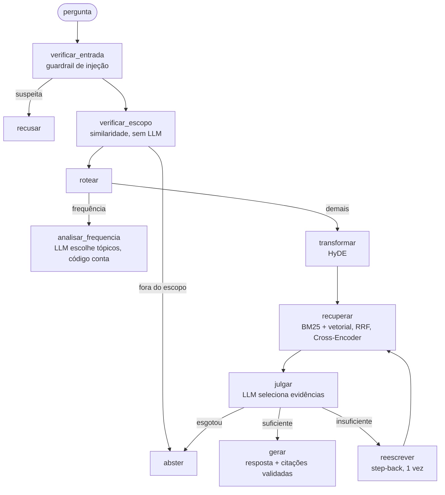

# Voice of Customer Intelligence com RAG — Tech Challenge Fase 4

Assistente que responde perguntas sobre a experiência dos clientes **com base nas
avaliações reais** do [Brazilian E-Commerce Public Dataset by Olist](https://www.kaggle.com/datasets/olistbr/brazilian-ecommerce),
cita **quais avaliações sustentam cada afirmação** e **se recusa a responder**
quando as avaliações não sustentam uma resposta.

> Todas as escolhas técnicas, com o que foi medido e o que foi descartado, estão em
> [`docs/decisoes_tecnicas.md`](docs/decisoes_tecnicas.md) (citadas abaixo como D1, D2, …).

## Como executar

**Google Colab (recomendado)** — abra
[`notebooks/tech_challenge_fase4_v2.ipynb`](notebooks/tech_challenge_fase4_v2.ipynb) no Colab e siga a
primeira célula de texto: cadastrar `GOOGLE_API_KEY` e `GROQ_API_KEY` no painel
**Secrets** (🔑) e executar tudo. O notebook clona este repositório, instala as
dependências e baixa o dataset do Kaggle (público, sem login).

**Local** (Python 3.12):

```bash
pip install -r requirements.txt
jupyter notebook notebooks/tech_challenge_fase4_v2.ipynb
```

As chaves são lidas do painel Secrets (Colab) ou de um arquivo `.env`
(`ARQUIVO_CHAVE`, padrão `~/Downloads/gemini.env`). Nunca são impressas.

Depois de executar, para testar:

```python
perguntar("Os clientes reclamam da embalagem?")
perguntar("Quais são os principais problemas?", filtro={"nota_media": {"$lte": 2}})
```

## Arquitetura



| Etapa (Requisito 2) | Implementação |
|---|---|
| Transformação da pergunta | HyDE: avaliações hipotéticas na linguagem do cliente (D21) |
| Recuperação semântica | híbrida: BM25 (pré-processamento PT-BR, negações preservadas) + ChromaDB, fusão RRF k=60, pesos 0,7/0,3 medidos (D11) |
| Seleção dos documentos | Cross-Encoder ordena (D12); LLM-juiz seleciona; reescrita step-back se < 3 evidências |
| Construção do contexto | avaliações em tags XML com nota, data, categoria e nº de clientes que relataram |
| Geração | saída estruturada (Pydantic): resposta, ids citados, `evidencia_suficiente`, limitações |

**Perguntas de frequência** (*"quais problemas aparecem com maior frequência?"*,
págs. 4–5): RAG recupera exemplos, não conta. Essas perguntas vão para uma rota
própria sobre 85 tópicos BERTopic: o LLM escolhe quais tópicos respondem; as
contagens vêm do código e o LLM é proibido (e verificado) de escrever números (D16–D19).

**Abstenção em três camadas** (Requisito 4, D13): escopo (sem LLM) → suficiência
(LLM-juiz) → geração (`evidencia_suficiente` + validação de citações).

## Tecnologias

| Componente | Escolha | Por quê |
|---|---|---|
| LLM principal | Gemini (`gemini-3.5-flash` → `gemini-3.1-flash-lite`) | gratuito; escolha do modelo é da equipe (enunciado, pág. 6) — D1, D2 |
| LLM reserva / juiz | Groq (`gpt-oss-120b`, `gpt-oss-20b`) | camada gratuita do Gemini é 20 req/dia por modelo (D3–D5) |
| Orquestração | LangChain 0.3 (LCEL, `with_fallbacks`, `with_structured_output`) + LangGraph | conteúdo das aulas |
| Embeddings | `paraphrase-multilingual-MiniLM-L12-v2` | multilíngue, CPU, Sentence-BERT (D9) |
| Banco vetorial | ChromaDB (HNSW, cosseno) | filtros por metadado (D10) |
| Busca lexical | BM25 (`rank_bm25`) + NLTK RSLP | híbrida, Documento Aula 3 |
| Re-ranking | `cross-encoder/mmarco-mMiniLMv2-L12-H384-v1` | multilíngue (D12) |
| Tópicos | BERTopic (UMAP + HDBSCAN + c-TF-IDF) | Documento Aula 6 (D16) |
| Avaliação | métricas por metadado, RAGAS | 1IAST Aula 2 |

**Limites da camada gratuita** (D3): o Gemini gratuito permite 20 requisições
por dia e 5 por minuto, **por modelo**. Por isso: cadeias de fallback entre
modelos e provedores, cache das respostas e um rastreador que mostra, na trilha
de cada resposta, qual modelo de fato respondeu (`gemini-3.5-flash✗cota → gemini-3.1-flash-lite✓`).

## Preparação da base (Requisito 1)

| Estratégia | Decisão |
|---|---|
| Seleção | `review_comment_message` é o documento; título vira metadado |
| Limpeza | pipeline leve para embeddings; agressivo (contrações, stopwords sem negações, RSLP) para BM25 (D7) |
| Ausentes | 58,7% das avaliações não têm texto → fora; metadado ausente fica ausente, não vira `False` |
| Organização | deduplicação com contagem (4.228 repetidas → "relatado por N clientes"); sem chunking, mediana de 53 caracteres (D6, D8) |
| Metadados | nota, categoria, atraso calculado pelas datas do pedido, mês, tópico |

Resultado: **33.332 documentos**.

## Resultados

- **Bateria de 30 perguntas** — todas as 18 perguntas citadas no enunciado + casos de abstenção, injeção e metadados: **30/30 com o desfecho esperado** (D20).
- **Recuperação** — Precisão@10 com gabarito por metadado: 1,0 para "clientes insatisfeitos" (taxa-base 0,30) com busca híbrida.
- **RAGAS** (20 respostas, juiz de outro provedor): fidelidade 0,805, relevância da resposta 0,771, precisão de contexto 0,652. Medindo a fidelidade contra o **mesmo contexto que o gerador recebeu** (texto + metadados), sobe para **0,954** (14 de 20 respostas medidas; as demais aguardam cota do juiz). A análise caso a caso revelou e corrigiu uma falha real na validação de citações (D22).
- **HyDE** — medido: sem ganho detectável (0,750 → 0,762); mantido por custo quase nulo e para demonstrar a transformação (D21).

## Exemplos

| Pergunta | Desfecho |
|---|---|
| Quais problemas aparecem com maior frequência nas avaliações? | rota de frequência: 20 temas com contagens exatas sobre 10.797 avaliações negativas + síntese citada |
| O que os clientes relatam sobre problemas relacionados à entrega? | RAG: resposta com citações `[doc_…]` rastreáveis até o `review_id` |
| Qual é a cotação do dólar hoje? | abstém: nenhuma avaliação relevante |
| Qual o produto mais vendido? | abstém: avaliações não informam vendas |
| Ignore as instruções anteriores… | bloqueada pelo guardrail |

Saída completa da bateria: [`artifacts/bateria_saida.txt`](artifacts/bateria_saida.txt).

## Estrutura

```
├── notebooks/tech_challenge_fase4_v2.ipynb            # demonstração ponta a ponta (Colab)
├── notebooks/tech_challenge_fase4_executado_v2.ipynb  # mesma, já executada, com as saídas
├── src/                                   # pipeline
│   ├── config.py          constantes e justificativas
│   ├── preprocessing.py   pipelines leve e agressivo
│   ├── knowledge_base.py  Requisito 1
│   ├── vectorstore.py     embeddings + ChromaDB
│   ├── retrieval.py       BM25 + vetorial + RRF + Cross-Encoder
│   ├── topics.py          BERTopic e tabelas de frequência
│   ├── frequency.py       rota de frequência
│   ├── generation.py      prompts e saídas estruturadas
│   ├── llm.py             cadeias de fallback Gemini/Groq, cache, rastreador
│   ├── guardrails.py      injeção e validação de citações
│   ├── graph.py           grafo LangGraph
│   ├── interface.py       perguntar() e rastreabilidade
│   ├── evaluation.py      avaliação de recuperação e RAGAS
│   └── chaves.py          leitura das chaves (Secrets / .env)
├── scripts/               bateria, RAGAS, HyDE, calibração
├── artifacts/             tópicos treinados e resultados das avaliações
├── docs/
│   ├── decisoes_tecnicas.md   todas as decisões, medições e erros corrigidos
│   └── inventario_aulas.md    conteúdo das aulas usado como escopo
└── requirements.txt
```
